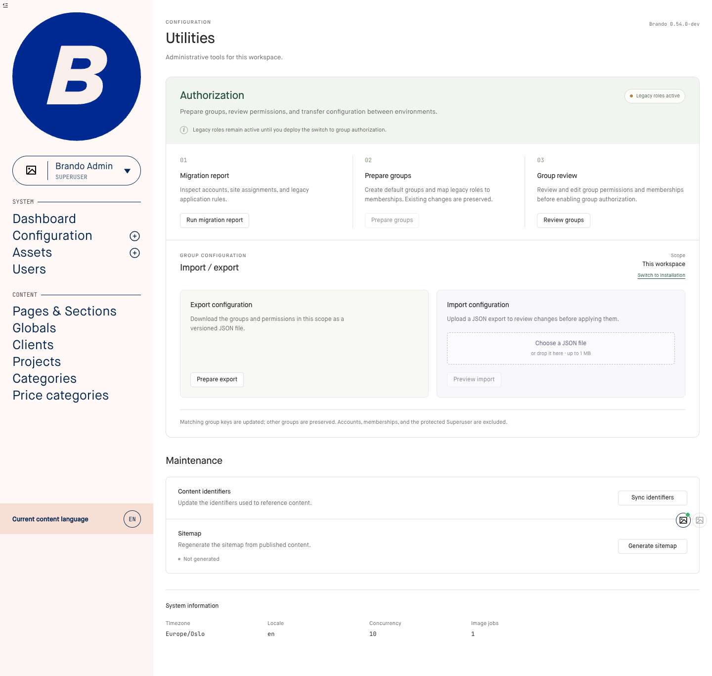
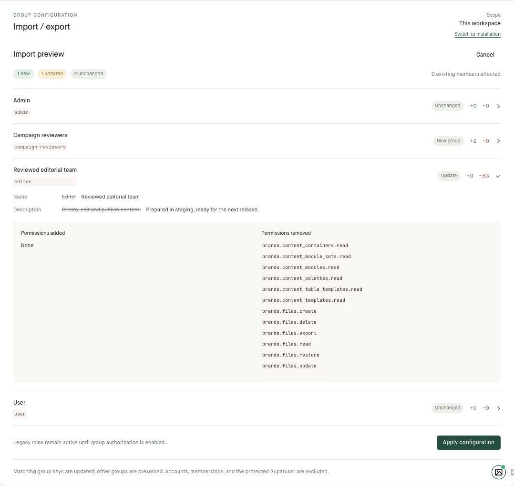

# Brando admin UI

The design direction approved in issue #2788 on 7 September 2026: restrained
colours, clear grouping, compact controls, deliberate spacing and factual copy.
Apply it alongside existing components and the screen's functional
requirements. The measurements are starting points from Utilities, not a
mandate to restyle every existing screen.

Every admin change follows the rules in this file. Then read the references
for the components the screen has; each one is the single home for its rules.

| Read | When the screen has or changes |
| --- | --- |
| [buttons-badges-menus.md](references/buttons-badges-menus.md) | Any button, badge, status chip or dropdown/menu row (`.btn`, `.badge`, `.menu-item`) |
| [typography-and-colour.md](references/typography-and-colour.md) | Text sizes, fonts, colours, tokens (`--brando-*`), application colour overrides |
| [tabs.md](references/tabs.md) | Tabs or tab-like section switches (`.pill-tabs`) |
| [motion.md](references/motion.md) | Transitions, animation, opening and closing panels |
| [ai-actions.md](references/ai-actions.md) | AI field actions, suggestions, generated text |
| [confirmations-alerts-toasts.md](references/confirmations-alerts-toasts.md) | Confirm dialogs, alerts, toasts, destructive actions |
| [text-diffs.md](references/text-diffs.md) | Showing changed text: revisions, imports, proposals |
| [external-references.md](references/external-references.md) | Links or IDs pointing outside the admin |
| [workspaces-and-form-sections.md](references/workspaces-and-form-sections.md) | Workspace screens, drawers, form sections |
| [listings-and-editors.md](references/listings-and-editors.md) | Content listings and entry editors |
| [entry-heading-and-settings.md](references/entry-heading-and-settings.md) | The entry editor heading, settings screens |
| [dashboard.md](references/dashboard.md) | The dashboard |
| [subform-tables.md](references/subform-tables.md) | Inline subform tables |
| [transformer-cards.md](references/transformer-cards.md) | Transformer fields with `layout :grid` |
| [gallery-grid.md](references/gallery-grid.md) | Gallery fields and blocks, the grid/list switch |
| [icons.md](references/icons.md) | Icons, Blueprint content-type icons, sidebar rows |
| [icon-buttons-and-tooltips.md](references/icon-buttons-and-tooltips.md) | Icon-only buttons and tooltips |
| [keyboard-shortcuts.md](references/keyboard-shortcuts.md) | Keyboard shortcuts |
| [modals.md](references/modals.md) | Modals and dialogs |
| [dropdowns-and-entry-panels.md](references/dropdowns-and-entry-panels.md) | Dropdowns, entry/relation pickers, identifier rows, entry panels |
| [screenshots.md](references/screenshots.md) | Taking screenshots of the admin (servers, seeding, PR shots) |

`:has()` scoping and sticky DOM rules are in AGENTS.md.

## Reference

The Utilities page is a worked example. Its main content shows the approved
spacing, action placement, maintenance rows, and system-information grouping.
The surrounding sidebar and avatar images come from the E2E fixture application.



The import preview shows how the same hierarchy extends to expanded details,
permission changes, and the final apply action.



Implementation references:

- [Utilities styles](../../../assets/css/views/config/Utils.css)
- [Authorization tools component](../../../lib/brando_admin/components/authorization_tools.ex)
- [Utilities LiveView](../../../lib/brando_admin/live/sites/utils_live.ex)

## Start with the task and hierarchy

Give each section a clear purpose and place its actions next to the relevant
content. Use one page title, section headings, and smaller item titles. Make
related items share alignment, spacing, and control treatment.

Choose a bounded width for settings and configuration. Utilities uses a 1120px
maximum; dense tables and editors may need more: listings stop at 1280px and
entry forms at 1400px (the form lifts its bound while the live preview is open). A wide monitor should not pull
short descriptions, actions, and metadata to opposite edges of the screen.

Use numbered steps for an actual sequence. Use cards to group distinct workflows
such as import and export. Use a single bordered list with dividers for simple
maintenance actions: description on the left, action on the right. Let content
determine row height. Oversized cards with one short sentence create unnecessary
empty space.

## Make spacing a system

Start with a small spacing scale: 4, 8, 12, 16, 24, and 32px. Adjust deliberately
for the existing layout and actual text wrapping.

| Relationship | Starting point |
| --- | --- |
| Item title to description | 4–8px |
| Description to action below it | At least 16px |
| Related actions | 8–12px |
| Card or settings-row padding | 20–24px |
| Major sections | 24–32px |
| Metadata label to value | 4px |

Separate button padding from the space around the button. Increasing button
height does not solve a button touching the paragraph above it.

### Let the layout own the gap

Brando's [global stylesheet](../../../assets/css/app.css) includes:

```css
p:last-of-type {
  margin-bottom: 0 !important;
}
```

This cancelled the intended paragraph margins in the first Utilities design.
Several buttons had a measured gap of zero despite apparently correct local CSS.
Use parent `gap` or padding on an action wrapper so spacing survives the reset:

```css
.screen-actions {
  display: flex;
  flex-wrap: wrap;
  align-items: center;
  gap: 12px;
  padding-top: 16px;
}

/* Within a column of related steps, align actions while retaining the gap. */
.screen-step .screen-actions {
  margin-top: auto;
}
```

Inspect computed styles before adding specificity or another `!important`.
Keep fixes scoped to the screen; changing a global reset needs a separate review
of the screens it affects. Measure the rendered gap after the longest description
wraps, as well as with shorter text.

## Keep controls compact and predictable

Use the shared `.btn` (see [Buttons and badges](references/buttons-badges-menus.md)) rather
than a button of the screen's own: 30px by default, 12px text, a 1px border and a
6px corner. Coarse-pointer controls use a minimum height of 40px; check touch
usability in context.

Align equivalent actions consistently. In a settings list, use a shared right
edge and consistent widths where the labels allow it. In parallel workflow
cards, align actions at the bottom while preserving a minimum gap from content.
On narrow screens, stack the action under its description with a 16px gap.

Give the main consequential action stronger emphasis. Keep navigation and
secondary actions quieter. Use verbs that describe the result: “Run migration
report”, “Sync identifiers”, “Preview import”, “Apply configuration”.

Use consistent icons from the existing icon system. A disclosure chevron should
have a consistent size, stroke, alignment, and open state. Omit decorative arrows
that add no information. Keep visible keyboard focus, accessible names for
icon-only controls, and understandable loading and disabled states.

### Native selects

Form fields use the existing admin select component. A small native select on
a configuration screen takes the shared `admin-select` treatment in
`assets/css/components/Form/Input/Select.css`, rather than browser-default
chrome or styling of its own: the surrounding inputs' height, font, radius and
focus ring, a small chevron inset from the right edge, and padding for long
translated labels. Check the closed control, the open options, keyboard
selection and the narrow layout in the browser, with screenshots, and read
the option labels on screen in Norwegian: status names and field labels show
their translations, not humanised English.

## Write factual, useful copy

Use the language of the task. Explain the action, relevant consequences, and the
next step when needed. Avoid cute catchphrases, promotional headings, and invented
personality. “Import / export” is a useful heading on an administrative screen.

Describe empty states naturally: “Not generated” for an absent sitemap, followed
by “Last generated: …” when a timestamp exists. Keep descriptions concise, but
preserve facts the user needs to act safely, such as whether an import affects
existing members.

## Present metadata as information

Use a semantic description list (`dl`, `dt`, `dd`) with labels above values and
consistent column spacing. Bound its width and reduce the column count on narrow
screens. Avoid distributing a handful of tiny label/value pairs across the full
viewport with `justify-content: space-between`.

Show effective configuration values. The initial Image jobs field was blank
because the setting was unset, although the application uses a default of 1.
Resolve the same default as the consuming code. If a value cannot be determined,
display a meaningful unknown state instead of inventing a value.

## Verify the rendered result

CSS that looks right in a diff is insufficient evidence of a finished layout.

Before editing, search the existing E2E tests for the page's route, labels, and
selectors. Include those tests in local validation alongside new tests. A new
workflow test does not replace existing coverage of the page's other actions.
Update assertions affected by an intentional redesign while preserving their
behavioral coverage. When fixing a failing test, rerun that specific test first.

1. Build changed JS/CSS through the E2E consumer, following [AGENTS.md](../../../AGENTS.md).
   Source `e2e/.envrc` first. Do not use a standalone root asset build as a gate.
2. Inspect the actual page with its real styles and fonts. Reload after rebuilding
   when hot reload is unavailable. Check computed styles when spacing disagrees
   with the source.
3. Check the normal desktop layout and narrow widths, including 390px. Look for
   overflow, awkward wrapping, missing values, crowded actions, and inconsistent
   alignment. Allow resize transitions to settle before taking screenshots.
4. Inspect relevant states: empty, loading, disabled, error, populated, and
   expanded details. Check keyboard focus and long labels or filenames where
   they occur. Run focused behavioral tests appropriate to the changes.
5. Take and inspect fresh screenshots. When presenting UI work, show the user a
   screenshot of the actual implementation. Keep saved reference images current
   when the approved design changes.

Take screenshots with the tools in [screenshots.md](references/screenshots.md).
