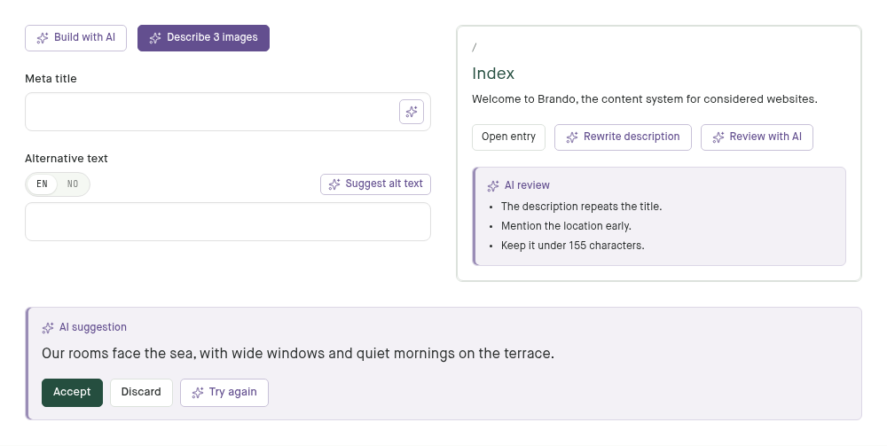

# AI actions and suggestions

The Assistant uses a violet orbit while a run is thinking, with a visible Stop
action. New tool-step labels reveal word by word in at most 440ms; the full text
and its final wrapping are present from the start. Replies enter in 350ms.
History and reconnects do not replay these effects. Both reduced-motion
preferences show the text immediately and leave the thinking indicator still.
In the E2E app, send **Preview assistant animations** to replay a paced,
read-only script without calling an AI provider. This demo exists only in
`E2eProject.AssistantModel`, never in the production model client.

Approved with issue #2983.
Everything AI in the admin uses two looks, so an editor recognises AI the same
way everywhere. Both are drawn in the AI violet, `--brando-ai` (`#634f8f`, 6.9:1
on white), and the tints mixed from it. An AI action sends the content to an
external AI service that is paid for by the request, so it is marked apart
from every other action, which uses the sage accent. Both looks live in
`assets/css/components/AI.css`.



**The AI action** is any control that asks AI for something: Build with AI,
Suggest alt text, a field's AI actions (`ai_actions:`, and Generate on the
meta fields), Write or Review with AI in Content SEO, Draw a sketch
with AI, Sketches with AI on the Modules screen, the rich-text editor's Write
with AI. It is a small secondary button: the
Lucide `sparkles` icon, `--brando-ai` text, a solid violet hairline
(`--brando-ai-line`, `--brando-ai-line-strong` on hover, over the
`--brando-ai-tint` surface), white, 30px high (the default `.btn` height) with a 5px radius. Render it
with `AIAction.button/1`:

```heex
<AIAction.button phx-click="suggest_alt_text" phx-target={@myself} size={:compact}>
  {gettext("Suggest alt text")}
</AIAction.button>
```

- `href` makes it a link (Build with AI opens the assistant in a new tab).
- `size={:compact}` (24px) beside a field's label; `size={:icon}` (28px
  square, with an `aria-label` and a `data-tooltip`, see
  [Icon-only buttons and tooltips](icon-buttons-and-tooltips.md)) where
  only the icon fits. No AI action sits
  inside a text field: a field's actions are beside its label.
- `busy` while the request runs: the sparkles pulse and the button stays
  fully visible; `disabled` fades it. Focus is a 2px `--brando-ai` outline.
- `variant={:primary}` fills it with the violet: the confirm step of a
  costed batch, after its estimate ("Write 3 descriptions", "Describe 3
  images", "Draw 4 sketches"), and the rich-text editor's Generate
  suggestion.
- In a toolbar, a menu or a list of choices, an AI item keeps the host's
  shape and only takes the violet and the sparkles (`.menu-item--ai` on a
  menu row, `.btn--ai` on a `.btn`): the rich-text toolbar's
  sparkles button, the listing's "Translate to" menu item (icon after the
  label, so the labels stay aligned), a suggestion's Try again, the
  assistant's "Let the assistant choose". The translation dialog's sparkles
  and spinner are violet too.
- The assistant's send button keeps its shape, filled with the violet;
  "Use the 2 I attached", which answers the assistant, is a `.btn--ai`.

For controls, the rule is the call, not the subject. Navigation to the
Assistant (its sidebar row, the command palette's "Ask the Assistant") and
the Assistant's own chrome (its heading, Apply, Share) call nothing and keep
the admin's look with the `sparkles` icon. Accepting or discarding a suggestion
calls nothing either. The "Assistant" author label and sparkle on a reply
use `--brando-ai` to identify an AI response; the message text stays neutral.

**The suggestion** is what AI hands back for review before it is content: a
rich-text rewrite, a Content SEO review, suggested meta descriptions or alt
text, what an assistant proposal adds or changes, a proposal from a connected
tool. It sits on the suggestion tint (`--brando-suggestion`, mixed lighter for
a panel) with a 3px `--brando-suggestion-line` rule down its left edge, and is
labelled with the sparkles in `--brando-suggestion-ink` ("AI suggestion", "AI
review"). All three are mixed from `--brando-ai`. Accept is the primary button
beside it, in the sage accent; Discard is secondary, and Try again is an AI
item.

- A panel: `.ai-proposal`, its label `.ai-proposal-label`, its buttons in
  `.ai-proposal-actions`.
- Suggested text the editor can still change before accepting
  (`SuggestionReview`): the textarea takes `.ai-proposal-field`.
- A field's AI actions (`Form.FieldActions`), in a form and its Meta
  drawer: one action is a compact AI action beside the label, several a
  "Write with AI" menu of AI items. The reply waits under the input as a
  panel with its text in an `.ai-proposal-field`, the action's name in the
  label, a count against the action's `max`, and Accept, Discard and Try
  again. A line in the attention
  ink warns when accepting drops rich text's formatting; when the field
  changed since the action ran, Accept turns into Replace under an alert.
- Suggest alt text (`Form.AltTextSuggestion`) waits under the alt field
  as a panel with one `.ai-proposal-field` per language, and Accept,
  Discard and Try again; accepted texts join the field's other languages.
- Write with AI in a rich-text editor shows its suggestion in the text, at
  the passage it rewrites, with its text in an `.ai-proposal-field` the
  editor can change before Accept inserts it.
- The assistant's proposals use the same tokens for new and changed blocks,
  and its list of proposals from connected tools marks those waiting for
  review with them.

Do not:

- use the AI violet for controls that do not call AI, or another colour for
  controls that do;
- draw an AI action or a suggestion with a dashed border — dashed means
  "drop here" in the block editor;
- write an AI result straight into a field: it waits as a suggestion until
  the editor accepts it, and only then is ordinary unsaved input;
- add a second AI button style for a new screen; add a size or a variant to
  `AIAction` instead.
